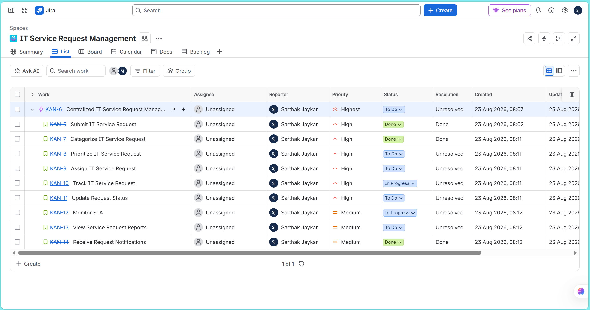
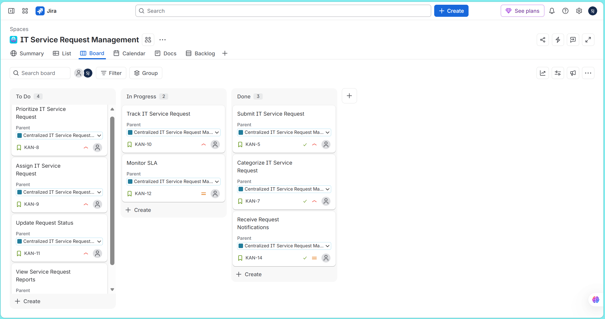
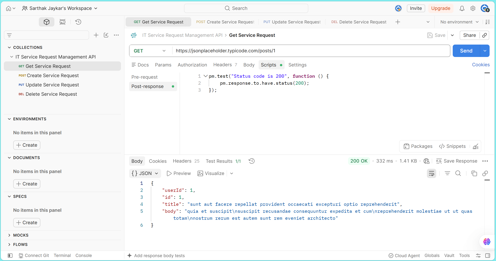

# IT Service & Ticket Management System

### Business Analysis Case Study

A Business Analyst case study focused on analyzing and documenting a centralized IT service desk solution for an organization with a distributed, manual IT support process.

**Focus areas:** Business Analysis · Requirements Engineering · BPMN 2.0 · User Stories · Jira · REST API Fundamentals · Postman

---

## Table of Contents

- [Project Overview](#project-overview)
- [Business Context](#business-context)
- [Problem Statement](#problem-statement)
- [Project Objectives](#project-objectives)
- [Proposed Solution](#proposed-solution)
- [Stakeholders](#stakeholders)
- [Project Scope](#project-scope)
- [Business Analysis Approach](#business-analysis-approach)
- [Key Requirements and Deliverables](#key-requirements-and-deliverables)
- [Process Models](#process-models)
- [User Stories and Prioritization](#user-stories-and-prioritization)
- [Jira Workflow](#jira-workflow)
- [API Analysis and Postman Demonstration](#api-analysis-and-postman-demonstration)
- [Tools and Technologies](#tools-and-technologies)
- [Repository Structure](#repository-structure)
- [Project Outcomes](#project-outcomes)
- [Assumptions and Limitations](#assumptions-and-limitations)

---

## Project Overview

The **IT Service & Ticket Management System** case study explores how an organization can replace fragmented IT support channels with a centralized process for submitting, assigning, tracking, and resolving employee IT service requests.

The work follows a Business Analysis lifecycle: understanding the business problem, identifying stakeholders, reviewing the current process, defining requirements, modelling a proposed process, documenting user stories, organizing work in Jira, and demonstrating basic REST API interactions in Postman.

This repository contains analysis and documentation artifacts. It does **not** contain a production-ready IT service desk application or a deployed backend.

## Business Context

The case study is based on **Devv Global**, a fictional mid-sized technology services company with approximately **500 employees** across multiple departments.

The internal IT Support team is responsible for handling:

- Hardware and software issues
- Access and account requests
- Network and connectivity problems
- Application support
- General IT service requests

Employees currently contact IT Support through several channels, including email, Microsoft Teams messages, phone calls, or direct conversations with IT staff.

## Problem Statement

Because IT requests arrive through different channels, the organization lacks a consistent way to record, categorize, prioritize, assign, and monitor them.

This fragmented process can lead to:

- Requests being missed or delayed
- Incomplete or inconsistent request information
- Different approaches to prioritizing urgent issues
- Unclear ownership of open requests
- Repeated status follow-ups from employees
- Limited visibility into SLA performance and IT workload
- Fragmented information for operational reporting

The business need is therefore to establish a standardized and trackable IT service-request process.

## Project Objectives

The proposed solution is intended to:

1. Centralize employee IT service requests through a single intake process.
2. Capture consistent information for each request.
3. Support prioritization based on impact and urgency.
4. Make request ownership and assignment visible to IT Support.
5. Allow employees to track the status of their requests.
6. Improve visibility into response and resolution timelines.
7. Provide basic reporting on request volume, status, priority, ownership, and resolution performance.

### Proposed Success Criteria

The case study identifies the following measures for evaluating the proposed solution:

- All IT requests are recorded through the centralized process.
- Employees can view the status of their submitted requests.
- Each request has a category, priority, and assigned owner at the appropriate stage of its lifecycle.
- IT management can monitor open requests and SLA status.
- Request history is available for tracking and reporting.

These are proposed success measures; they have not been measured against a live production implementation.

## Proposed Solution

The proposed system introduces a structured service-request lifecycle:

**Submit → Categorize → Prioritize → Assign → Track → Resolve → Close**

At a high level:

1. An employee submits an IT service request through a centralized channel.
2. Standard request information is captured.
3. IT Support reviews the request and confirms its category and priority.
4. The request is assigned to an IT Support agent.
5. The employee and IT Support can follow the request status.
6. IT Support records the resolution and updates the request.
7. IT management can review request and SLA information through basic reports.

The documented request statuses are:

`New → Assigned → In Progress → Resolved → Closed`

## Stakeholders

| Stakeholder | Role in the process | Primary need |
|---|---|---|
| Employees | Submit and track IT requests | Simple submission and status visibility |
| IT Support Agents | Review and resolve requests | A clear queue, priority, and ownership |
| IT Support Manager | Oversee IT service operations | SLA and workload visibility |
| Department Managers | Represent department-level business needs | Reduced employee downtime and visibility into critical issues |
| HR / Admin | Support employee and access-related coordination | Efficient coordination with IT |
| Project / Product Owner | Make business decisions and guide delivery | Business value and successful delivery |

## Project Scope

### In Scope

- Employee IT service-request submission
- Standardized request information
- Request categorization
- Priority assignment
- IT assignment and ownership
- Request status tracking
- Request updates and resolution
- SLA tracking
- Basic request reporting
- Notifications and status communication

### Out of Scope

- Implementation of actual IT infrastructure
- Hardware procurement
- Payroll and general HR processes
- Financial processes
- Advanced AI chatbot capabilities
- Full IT asset-management functionality
- Detailed production deployment

## Business Analysis Approach

The work is organized around the following sequence:

**Business Problem → Stakeholder Analysis → Scope Definition → AS-IS Analysis → Gap Analysis → Requirements → TO-BE Process → User Stories → Jira Backlog → API Demonstration**

| Stage | Analysis activity | Supporting artifact |
|---|---|---|
| 1. Understand | Define the business context and problem | Project overview and business problem |
| 2. Discover | Identify stakeholders, needs, assumptions, and scope | Stakeholder and scope documentation |
| 3. Assess | Review the current process and identify gaps | AS-IS process and gap analysis |
| 4. Specify | Define business, functional, and non-functional requirements | BRD and requirements documentation |
| 5. Model | Describe the proposed future process | TO-BE process model |
| 6. Elaborate | Translate requirements into user stories and acceptance criteria | User Stories and Acceptance Criteria |
| 7. Organize | Structure and prioritize work in an Agile-style backlog | Jira epic, stories, and Kanban evidence |
| 8. Demonstrate | Explore basic REST API operations and response validation | Postman collection and test evidence |

## Key Requirements and Deliverables

The requirements documentation includes the following:

| Deliverable | Coverage |
|---|---|
| Business Requirements | Centralized intake, standardized information, prioritization, ownership, tracking, SLA visibility, and reporting |
| Functional Requirements | Request submission, request data capture, categorization, prioritization, assignment, status management, reporting, and notifications |
| Non-Functional Requirements | Usability, performance, availability, security, auditability, and scalability |
| Business Rules | Required request information, priority, ownership, access to assignment changes, closure conditions, and priority-based SLA targets |
| User Stories | Core needs of employees, IT Support Agents, and IT Support Managers |
| Acceptance Criteria | Conditions describing expected behavior for the documented user stories |
| Requirements Traceability | Mapping between business requirements and related user stories |
| Gap Analysis | Seven process gaps, their root causes, and business impacts |

### Example Functional Capabilities

- Employees can submit IT service requests.
- The system captures requester details, category, description, urgency, and submission date/time.
- IT Support can review, categorize, prioritize, and assign requests.
- The request lifecycle is represented through defined statuses.
- Employees can view their submitted requests and current status.
- Request timestamps support SLA monitoring.
- Managers can review basic request and resolution reports.
- Notifications can be triggered by key request events.

## Process Models

The repository includes current-state and proposed-state process models created for the case study.

### AS-IS Process

The current-state model represents a fragmented process in which employees contact IT through multiple channels and requests are recorded and followed up manually.


### TO-BE Process

The proposed-state model represents a centralized process intended to improve request capture, prioritization, assignment, status visibility, and SLA monitoring.


The editable Draw.io source file is available at:

`process-models/IT mgmt draws.drawio`

## User Stories and Prioritization

The case study documents core user stories for the main roles.

Examples include:

- **Submit Request:** As an employee, I want to submit an IT service request so that I can get IT support.
- **Categorize Request:** As an IT Support Agent, I want to categorize requests so that they can be handled appropriately.
- **Prioritize Request:** As an IT Support Agent, I want to prioritize requests based on impact and urgency so that critical issues are handled first.
- **Assign Request:** As an IT Support Manager, I want to assign requests to IT Support Agents so that every request has clear ownership.
- **Track Request:** As an employee, I want to view my request status so that I can follow its progress.
- **Update Request:** As an IT Support Agent, I want to update request status so that the request lifecycle is accurately tracked.
- **Monitor SLA:** As an IT Support Manager, I want to monitor SLA performance so that delayed requests can be identified.
- **View Reports:** As an IT Support Manager, I want to review service-request reports so that I can monitor workload and performance.

The documented MoSCoW prioritization classifies the core submission, categorization, prioritization, assignment, tracking, and status-update stories as **Must Have**. SLA monitoring and reporting are classified as **Should Have**.

The complete user-story and acceptance-criteria document is available in `user-stories/`.

## Jira Workflow

Jira evidence is included to demonstrate how the case-study work can be organized into an Epic, user stories, priorities, and a Kanban workflow.

The screenshots show:

- The IT Service Request Management Epic and related user stories
- A Kanban board with the workflow columns `To Do`, `In Progress`, and `Done`

### Jira Backlog



### Jira Kanban Board



The Jira screenshots are portfolio evidence; this repository does not provide a live Jira project link.

## API Analysis and Postman Demonstration

A Postman collection is included to demonstrate basic HTTP operations and response validation using a **mock REST API**.

The collection uses JSONPlaceholder endpoints under `/posts`. These are demonstration endpoints, not endpoints from a custom IT service-request backend.

| Method | Demonstration endpoint | Intended operation | Evidence in the current collection |
|---|---|---|---|
| GET | `/posts/1` | Retrieve a record | A `200 OK` response and status-code assertion are shown in the Postman evidence |
| POST | `/posts` | Submit a record | Request body and `201 Created` assertion are included |
| PUT | `/posts/1` | Update a record | Request is included; a response assertion is not configured in the current collection |
| DELETE | `/posts/1` | Delete a record | Request is included; a response assertion is not configured in the current collection |

The example POST body uses fields such as `title`, `body`, and `userId`. These are mock API fields and should not be interpreted as the final data model for an IT service-request platform.

### Postman Evidence



The collection can be found in:

`api-testing/IT Service Request Management API.postman_collection.json`

**Important:** This exercise demonstrates familiarity with HTTP methods, JSON request bodies, API responses, and basic Postman assertions. It does not validate a production ITSM API, and the mock service does not provide a persistent service-request backend.

## Tools and Technologies

| Tool | Purpose in this case study |
|---|---|
| Confluence | Organizing business documentation, requirements, user stories, and acceptance criteria |
| Draw.io | Creating AS-IS and TO-BE process models |
| BPMN 2.0 | Representing business-process flows |
| Jira | Organizing the Epic, user stories, priorities, and Kanban workflow |
| Postman | Demonstrating REST API requests and response validation |
| GitHub | Versioning and presenting project artifacts |

## Repository Structure

```text
IT-Service-Ticket-Management-System/
│
├── README.md
│
├── api-testing/
│   ├── IT Service Request Management API.postman_collection.json
│   └── postman-api-test-result.png
│
├── documentation/
│   └── IT-Service-Ticket-Management-System-Business-Analysis-Report.pdf
│
├── jira/
│   └── jira-kanban-board.png
│
├── process-models/
│   ├── IT mgmt draws.drawio
│   ├── IT mgmt draws-AS-IS process.drawio.png
│   └── IT mgmt draws-TO-BE process.drawio.png
│
├── requirements/
│   ├── IT-Service-Request-Management-BRD.pdf
│
└── user-stories/
    └── User-Stories-and-Acceptance-Criteria.pdf
```

## Project Outcomes

This case study demonstrates practice in:

- Translating a business problem into structured requirements
- Identifying stakeholder needs and defining project scope
- Reviewing a current process and documenting process gaps
- Modelling a proposed business process
- Writing business, functional, and non-functional requirements
- Creating user stories and acceptance criteria
- Connecting business requirements to user stories
- Organizing work in an Agile-style Jira backlog
- Understanding basic REST API operations and Postman response checks

## Assumptions and Limitations

- **Fictional business scenario:** Devv Global and its organizational context are used for this case study; they do not represent a verified client engagement.
- **Proposed solution:** The repository documents a proposed process and requirements. It does not contain a deployed IT service desk application.
- **Mock API:** API examples use JSONPlaceholder `/posts` endpoints rather than a custom ITSM backend.
- **Testing scope:** The current API evidence is a learning demonstration, not a complete API test suite or end-to-end UAT execution.
- **SLA configuration:** The requirements state that SLA targets depend on request priority, but a complete numerical priority-to-SLA matrix is not defined in the current materials.
- **Production readiness:** Security architecture, integrations, operational monitoring, and deployment would require further analysis before implementation.

---

